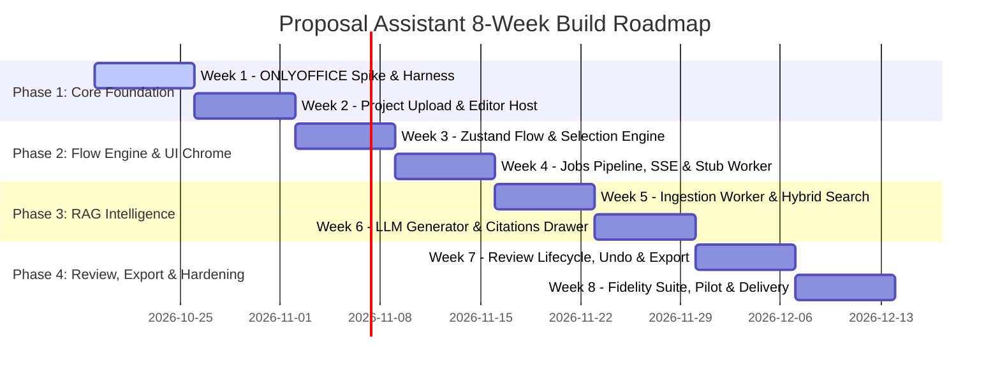

# Master Implementation Plan: Proposal Assistant (Excel MVP)

**Source:** Synthesized from [`LLD – Proposal Assistant.docx`](file:///Users/yashwant/Desktop/Chai%20aur%20Code/Proposal%20Assistant/.memory/LLD%20–%20Proposal%20Assistant.docx) §10, [`HLD`](file:///Users/yashwant/Desktop/Chai%20aur%20Code/Proposal%20Assistant/.memory/HLD%20–%20Proposal%20Assistant.docx) §12, and technical specifications.

---

## 1. Monorepo Architecture & Directory Layout

```
proposal-assistant/
├── apps/
│   ├── web/                                 # Next.js 14/15 Frontend Application
│   │   ├── app/
│   │   │   ├── (auth)/login/page.tsx        # Authentication & session handling
│   │   │   ├── (dashboard)/
│   │   │   │   ├── layout.tsx               # Sidebar, header, workspace switcher
│   │   │   │   ├── projects/page.tsx        # Project list, upload modal, stats
│   │   │   │   ├── projects/[id]/page.tsx   # Workspace editor screen (document box)
│   │   │   │   ├── knowledge/page.tsx       # Knowledge base collateral manager
│   │   │   │   └── settings/page.tsx        # Workspace, billing, model config
│   │   │   └── api/                         # Next.js edge proxies / auth routes
│   │   ├── components/
│   │   │   ├── document-box/
│   │   │   │   ├── EditorHost.tsx           # ONLYOFFICE iframe & connector initializer
│   │   │   │   ├── AddAnswerButton.tsx      # Pinned top-right pointer-down trigger
│   │   │   │   ├── StepBanner.tsx           # Animated guidance banner (Framer Motion)
│   │   │   │   └── QuestionChip.tsx         # Render selected question text + badge
│   │   │   ├── drawer/
│   │   │   │   ├── AnswerDrawer.tsx         # Slide-over review drawer
│   │   │   │   ├── SourcesList.tsx          # Grounded citation cards with scores
│   │   │   │   └── ReviewActions.tsx        # Accept, Edit, Regenerate, Undo buttons
│   │   │   ├── activity/
│   │   │   │   └── ActivityList.tsx         # Sidebar drawer of all filled cells
│   │   │   └── common/                      # shadcn/ui buttons, dialogs, toasts
│   │   ├── lib/
│   │   │   ├── editor/
│   │   │   │   ├── EditorAdapter.ts         # Abstract interface definition
│   │   │   │   └── OnlyOfficeExcelAdapter.ts# ONLYOFFICE spreadsheet implementation
│   │   │   ├── flow/
│   │   │   │   └── flowStore.ts             # Zustand state machine store
│   │   │   └── api/
│   │   │       ├── client.ts                # Typed Axios / fetch client
│   │   │       └── useJobStream.ts          # Resilient SSE streaming hook
│   │   └── package.json
│   │
│   └── api/                                 # FastAPI Python Backend
│       ├── app/
│       │   ├── main.py                      # FastAPI application entrypoint
│       │   ├── core/
│       │   │   ├── config.py                # Environment settings (Pydantic Settings)
│       │   │   ├── security.py              # JWT, Argon2, ONLYOFFICE shared secrets
│       │   │   ├── storage.py               # MinIO / AWS S3 client wrapper
│       │   │   └── database.py              # Async SQLAlchemy 2.0 session factory
│       │   ├── models/                      # SQLAlchemy Declarative Models
│       │   │   ├── workspace.py
│       │   │   ├── user.py
│       │   │   ├── project.py
│       │   │   ├── job.py
│       │   │   ├── answer.py
│       │   │   └── knowledge.py
│       │   ├── schemas/                     # Pydantic v2 Request/Response DTOs
│       │   │   ├── project_dto.py
│       │   │   ├── job_dto.py
│       │   │   ├── answer_dto.py
│       │   │   └── knowledge_dto.py
│       │   ├── routers/
│       │   │   ├── auth.py
│       │   │   ├── projects.py              # Upload, metadata, ONLYOFFICE config
│       │   │   ├── jobs.py                  # Job enqueue, cancellation, SSE relay
│       │   │   ├── answers.py               # Review patch, regeneration
│       │   │   ├── knowledge.py             # Collateral upload & chunk stats
│       │   │   └── editor_callback.py       # ONLYOFFICE save webhook handler
│       │   ├── services/
│       │   │   ├── project_service.py
│       │   │   ├── job_service.py
│       │   │   ├── export_service.py
│       │   │   └── kb_service.py
│       │   ├── workers/
│       │   │   ├── celery_app.py            # Celery worker configuration
│       │   │   ├── answer_worker.py         # run_answer_job task
│       │   │   └── ingestion_worker.py      # run_kb_ingestion_job task
│       │   └── rag/
│       │       ├── retriever.py             # PostgreSQL hybrid (tsvector + HNSW)
│       │       ├── reranker.py              # Cross-encoder reranker
│       │       ├── generator.py             # Claude API streaming generator
│       │       └── prompts.py               # Grounded prompt templates
│       ├── alembic/                         # Database migrations
│       └── requirements.txt
│
├── infra/
│   ├── docker-compose.yml                   # Local stack: web, api, worker, pg, redis, minio, onlyoffice
│   ├── onlyoffice/                          # Document Server container configs
│   └── nginx/                               # Gateway reverse-proxy configuration
│
└── packages/
    └── contracts/                           # Shared OpenAPI spec & generated TS types
```

---

## 2. Phase-by-Phase Roadmap (8 Weeks to MVP)



---

### Phase 1: Core Foundation & Editor Validation

#### **Week 1: ONLYOFFICE Spike & Feasibility Verification**
- **Objective:** Eliminate architectural risk D1/D2 before building full application layer.
- **Tasks:**
  1. Stand up local Docker environment running ONLYOFFICE Document Server, MinIO, and a minimal Node.js host.
  2. Test iframe embedding: verify programmatic token signing and document loading.
  3. Validate connector capabilities:
     - Programmatically retrieve active cursor/cell address via `GetSelection()`.
     - Programmatically write text into a target cell.
     - Inspect and write into merged ranges (`GetMergeInfo`).
     - Test cell styling and background color manipulation for AI draft tinting.
  4. Test ONLYOFFICE save callback cycle: verify document flush, webhook payload, and binary retrieval.
- **Verification Milestone:** A standalone script that opens an `.xlsx` file, captures cell `B14`, writes *"Verified Connector"*, applies a blue tint, and persists the modified file.

#### **Week 2: Project Upload, Storage & Editor Host**
- **Objective:** Build end-to-end project initialization and editor integration.
- **Tasks:**
  1. Configure PostgreSQL with `uuid-ossp`, `pgcrypto`, and `vector` extensions; initialize Alembic migration framework.
  2. Implement S3/MinIO storage service (`storage.py`) with signed URL generation.
  3. Implement `POST /api/projects` and `GET /api/projects/{id}` in FastAPI.
  4. Create ONLYOFFICE webhook router (`POST /api/editor/callback`) with JWT verification, saving changed working copies to S3 and rotating document keys.
  5. Implement `EditorHost.tsx` in Next.js to securely initialize the ONLYOFFICE iframe using server-provided `editorConfig`.
- **Verification Milestone:** User can upload an `.xlsx` file via Next.js UI, see it rendered inside ONLYOFFICE with 100% fidelity, make manual edits, and verify that changes are saved to object storage.

---

### Phase 2: Flow Engine & Real-Time Streaming

#### **Week 3: Zustand Flow State Machine & Anchor Capture**
- **Objective:** Implement the in-situ **"Pick Target → Pick Question → Go"** UX state machine.
- **Tasks:**
  1. Build `flowStore.ts` in Zustand implementing guarded transitions: `IDLE` → `PICK_QUESTION` → `READY` → `GENERATING` → `REVIEW`.
  2. Implement `OnlyOfficeExcelAdapter.ts` adhering strictly to `EditorAdapter.ts`.
  3. Build `AddAnswerButton.tsx` pinned to the top-right of the document container with `onPointerDown` capture to eliminate focus loss.
  4. Implement `StepBanner.tsx` with Framer Motion slide-down animations providing visual guidance.
  5. Build `QuestionChip.tsx` showing the captured question text, cell address, and clear button.
- **Verification Milestone:** Clicking "Add Answer" freezes cell `C14`, clicking cell `B14` captures question text into the banner chip, and enables the "Go" button.

#### **Week 4: Async Jobs Pipeline, Redis Celery & SSE Relay**
- **Objective:** Establish the non-blocking background execution and live streaming pipeline.
- **Tasks:**
  1. Build `POST /api/projects/{id}/jobs` to persist `answer_job` records and enqueue Celery tasks.
  2. Configure Redis pub/sub channel `job:{id}` and build the SSE router `GET /api/jobs/{id}/stream`.
  3. Implement heartbeat dispatching (every 15s) and reconnect recovery logic in `useJobStream.ts`.
  4. Build a mock answer worker that streams simulated tokens with throttled cell writes (150ms interval).
  5. Implement job cancellation (`POST /api/jobs/{id}/cancel`).
- **Verification Milestone:** Pressing "Go" initiates an async job; mock tokens stream smoothly both into the Next.js UI and directly into the target spreadsheet cell.

---

### Phase 3: RAG Intelligence & Grounded Generation

#### **Week 5: Knowledge Base Ingestion & Hybrid Search**
- **Objective:** Build multi-tenant document chunking, embedding, and hybrid retrieval.
- **Tasks:**
  1. Build Knowledge Base UI (`knowledge/page.tsx`) with drag-and-drop file upload.
  2. Implement `run_kb_ingestion_job` in Celery:
     - Document text extraction for PDF, DOCX, XLSX, and TXT.
     - Semantic chunking (300–500 tokens with 50-token overlap, preserving tables).
     - Batched vector embedding generation (1024-dim).
     - Insertion into `kb_chunk` table with automatic `tsvector` generation.
  3. Implement `Retriever` module in Python executing Reciprocal Rank Fusion (RRF) between full-text search (`tsvector`) and vector search (`pgvector` HNSW cosine similarity).
- **Verification Milestone:** Uploading a 50-page security whitepaper parses into chunks; querying *"What is your data retention period?"* retrieves top 30 relevant chunks in $< 150$ ms.

#### **Week 6: Grounded Generator, Citations & Hallucination Guardrail**
- **Objective:** Connect production LLM (Claude API) with strict RFP guardrails and citation UI.
- **Tasks:**
  1. Implement `Reranker` to filter top 30 candidate chunks down to the 6 most relevant passages.
  2. Implement the `MIN_SCORE` threshold: publish `NO_SOURCE` if no passage exceeds relevance threshold.
  3. Build `Generator` streaming Claude API completions using the grounded prompt template with character limit constraints.
  4. Implement `AnswerDrawer.tsx` sliding out from the right:
     - Formatted answer text preview
     - Confidence indicator badge (`HIGH`, `MEDIUM`, `LOW`)
     - Interactive citation cards (`SourcesList.tsx`) showing source filename, section, and text snippet.
- **Verification Milestone:** Pressing "Go" on a known question generates a citation-backed answer streamed into the cell and drawer. Pressing "Go" on an irrelevant question safely triggers `NO_SOURCE` without hallucination.

---

### Phase 4: Review Lifecycle, Export & Production Hardening

#### **Week 7: Review Lifecycle, Zero-Risk Undo & Export Engine**
- **Objective:** Complete the document editing lifecycle and export service.
- **Tasks:**
  1. Implement snapshotting in `OnlyOfficeExcelAdapter`: captures pre-write value, formula, and style.
  2. Implement `Accept()`: clears AI draft blue tint, sets DB answer status to `ACCEPTED`.
  3. Implement `Undo()`: executes `adapter.restoreCell(...)`, reverting cell instantly to pre-generation state and setting DB status to `UNDONE`.
  4. Implement `Edit()`: allows inline editing in the drawer with synchronized write back to the cell.
  5. Build `ActivityList.tsx` showing all answered cells with jump-to-cell navigation (`adapter.goTo(anchor)`).
  6. Implement `ExportService`:
     - Dispatches force-save command to ONLYOFFICE Docs server.
     - Waits for confirmation webhook.
     - Checks for unreviewed draft cells and presents warning if any remain.
     - Generates pre-signed download URL for `<original>_filled.xlsx`.
- **Verification Milestone:** User answers 5 questions, accepts 4, undoes 1, and downloads the filled workbook with all formulas, styles, and merges 100% intact.

#### **Week 8: Fidelity Suite, Security Audit & Pilot Delivery**
- **Objective:** Rigorous automated validation, security checks, and production readiness.
- **Tasks:**
  1. **Fidelity Suite Testing:** Create automated test suite with 20 real-world RFP workbooks. Compare exported `.xlsx` files against original files using `openpyxl` to assert:
     - Zero unrequested style/font mutations
     - Unaltered formula references
     - Preserved merged cell spans
     - Preserved sheet tabs and hidden columns.
  2. **Security & Isolation Testing:** Automated tests verifying tenant separation (workspace A cannot read workspace B documents, jobs, or S3 objects).
  3. **Load & Concurrency Testing:** 20 concurrent simulated users executing "Add Answer" flows; evaluate time-to-first-token and Redis queue behavior.
  4. Container hardening, environment configuration documentation, and user onboarding walkthrough.
- **Verification Milestone:** 100% pass rate across the 20-file RFP Fidelity Suite; production Docker Compose deployment operational.
